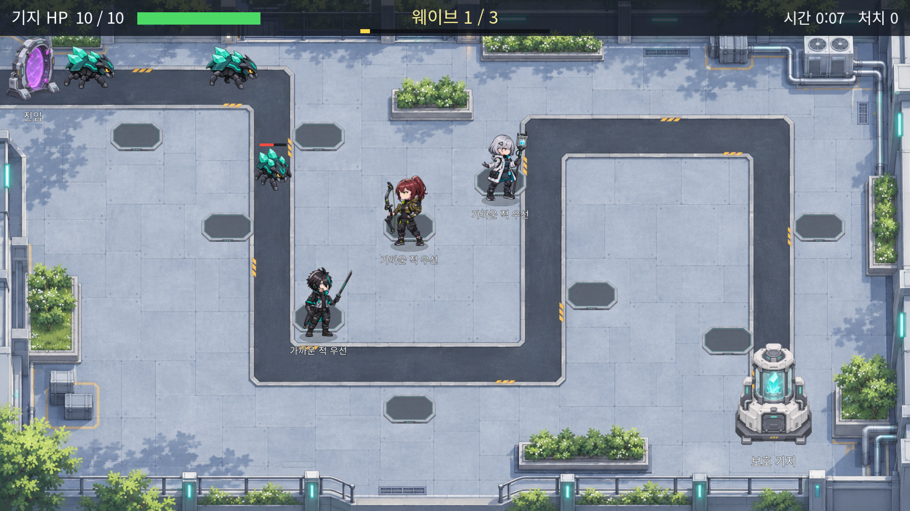

# world-game · AI 디펜스

캐릭터와 협력하는 약 5분 분량의 **오프라인 교육용 타워디펜스**입니다. 8명의 요원 중 3명을 선택해 배치하고 행동 원칙을 정하면, 캐릭터가 적을 골라 싸우고 전황을 보고합니다. 위기 상황에서는 원칙 변경의 장점과 단점을 제안하며, 최종 결정은 플레이어가 내립니다.

2026-11-12 바탕화면에 남아 있던 배포 폴더의 `source.zip`에서 프로젝트를 복원했습니다. **복원한 361개 파일은 원본 ZIP과 SHA-256 비교 결과 모두 동일합니다.** 게임 코드와 에셋은 수정하지 않았습니다. 과거 Git 이력은 포함되어 있지 않아 이 복원본부터 변경 이력을 시작합니다.



## 실행본 다운로드

[GitHub Releases](https://github.com/Erinis4522/world-game/releases)에서 `world-game-windows.zip`을 내려받아 전체 압축을 풉니다.

- **한 모니터:** `한화면_실행.cmd`
- **두 모니터:** Windows 디스플레이를 확장한 뒤 `체험센터_실행.cmd`
- **단축키:** F9 화면 역할 교환 · F10 교사 메뉴 · F11 전체 화면 · Shift+Esc 종료

이 배포본은 `AIDefense.exe`와 별도의 `AIDefense.pck`가 함께 있어야 합니다. CMD 실행 파일이 PCK를 지정하므로 CMD로 시작하세요. 실행본 ZIP에는 라이선스 문서, 원본 `source.zip`, 기존 미리보기와 검증 기록도 함께 보관합니다.

## 구현 내용

| 항목 | 확인한 상태 |
|---|---|
| 엔진 | Godot 4.7.2 Standard, GDScript, Compatibility 렌더러 |
| 캐릭터 | 8명, 전신 일러스트·SD·12개 독립 파츠씩 총 96개 |
| 맵·적 | 연구시설 외곽 맵, 일반·빠른·장갑·보스 4종, 방향/보행 프레임 16개 |
| 진행 | 선택 → 배치·원칙 설정 → 3개 웨이브 → 결과 |
| 행동 원칙 | 가까운 적 우선 / 위험한 적 우선 / 특기 활용 |
| AI | 가중치 기반 표적 선택, 전투 관찰, 복사한 상태를 이용한 대안 비교 |
| 화면 | 한 프로세스의 전투 창과 조작 창, 단일/듀얼 모니터 지원 |
| 콘텐츠 | GDScript 43개, PNG 125개, JSON 13개 |

AI는 게임 규칙에 따른 Utility AI입니다. 외부 생성형 AI API를 호출하거나 플레이 중 신경망을 학습하는 방식은 아닙니다. 전투 상태와 UI가 분리되어 있어 같은 전투 로직을 자동 검사와 밸런스 시뮬레이션에 사용합니다.

## 프로젝트 구조

```text
ai_defense/
  project.godot       Godot에서 열 프로젝트
  data/              캐릭터·적·웨이브·맵·대사 JSON
  src/core/          상태, 데이터 로딩, 30Hz 전투 시뮬레이션
  src/ai/            표적 선택, 관찰, 위기 감지, 원칙 변경 제안
  src/app/           한 판의 진행과 명령 처리
  src/view/          전투·조작 UI와 캐릭터 애니메이션
  src/assets/        에셋 검색과 대체 그림 처리
  assets/            캐릭터, 관절 파츠, 몬스터, 맵, 폰트
  tests/             자동 로직·에셋 검사
  tools/             밸런스·성능·화면 점검 도구
  docs/              캐릭터와 월드 아트 설명
previews/            기존 실제 게임 화면
verification/        기존 검증 기록과 복원 후 재검사 기록
```

상세 동작은 [기존 개발 문서](ai_defense/README.md), [캐릭터 설계](ai_defense/docs/CHARACTER_DESIGN.md), [맵·몬스터](ai_defense/docs/WORLD_ART.md), [에셋 규격](ai_defense/assets/README.md)을 참고하세요. 기존 개발 문서에는 이전 버전의 구현 상태와 검사 개수가 일부 남아 있으며, 현재 복원본 상태는 이 README와 새 검사 로그를 기준으로 합니다.

## 소스로 개발하기

Godot 4.7.2 Standard에서 `ai_defense/project.godot`를 열면 됩니다. Windows PowerShell에서는 설치한 엔진 경로를 지정해 아래 명령으로 실행할 수 있습니다.

```powershell
# 실제 설치한 Godot 콘솔 실행 파일 경로로 변경
$godot = 'C:\tools\Godot_v4.7.2-stable_win64_console.exe'

# 저장소 루트에서 실행: 에셋 가져오기 → 검사 → 게임 실행
& $godot --headless --editor --path .\ai_defense --import
& $godot --headless --path .\ai_defense --script res://tests/run_tests.gd
& $godot --path .\ai_defense -- --single --windowed
```

## 복원 후 검증 · 2026-11-12

- Godot 4.7.2로 프로젝트와 126개 리소스 가져오기 성공.
- 자동 검사 **17개 테스트 묶음 / 914개 확인 통과, 0개 실패**. [새 로그](verification/recovery-2026-11-12/tests.log)
- 보관된 EXE+PCK를 headless 모드로 120프레임 실행: 종료 코드 0, 표준 오류 출력 없음. [새 실행 로그](verification/recovery-2026-11-12/packaged-stdout.log)
- 원본 ZIP의 361개 파일과 복원 소스의 SHA-256 일치 확인. [복원 기록과 해시](verification/recovery-2026-11-12/recovery.json)
- 일반적인 토큰·비밀키 패턴 검색에서 일치 항목 없음. GDScript에서 주요 네트워크/외부 프로세스 실행 API 사용도 발견되지 않음. 정식 보안 감사를 의미하지는 않습니다.

`verification/team1`, `team2`, `packaged`의 화면과 보고서는 기존 배포 폴더에 있던 기록입니다. 복원 당일 전체 GUI 플레이나 실제 듀얼 터치 모니터 검사를 새로 수행한 것은 아닙니다. 기존 기록의 `remote_pushed: false`는 당시 상태를 보존한 값입니다.

## 이어서 작업할 때 확인할 점

1. 기존 `run_tests.ps1`과 `build_exe.ps1`은 `../tools/godot/`의 고정 경로를 참조합니다. 이 엔진 폴더는 원본 ZIP에 없으므로 위 직접 실행 명령을 사용하거나 개발 환경에 맞게 경로를 정리해야 합니다.
2. `build_exe.ps1`이 복사하는 `ai_defense/dist/`도 원본 ZIP에 없습니다. 정식 새 EXE 빌드 전에 시작 배치파일과 내보내기 템플릿을 준비해야 합니다. Releases의 기존 실행본은 해당 폴더 없이 실행됩니다.
3. `run_tests.ps1`의 `anim` 분기에는 출력 경로 문자열 손상이 남아 있습니다. 애니메이션 미리보기 도구를 실행하기 전에 경로를 수정해야 합니다.
4. 기존 문서가 참조하는 `AI_디펜스_PRD_v1.md`와 별도 원본 아트/생성 워크플로 패키지는 이 배포 폴더에서 발견되지 않았습니다. 실행에 필요한 코드·이미지·폰트는 포함되어 있습니다.
5. 사운드, 운영 PC 성능 실측, 실제 학생·터치 모니터 수용 검사는 기존 문서상 미완료 항목입니다.

## 라이선스 자료

Godot 및 포함 라이브러리 고지는 [Godot_licenses.txt](Godot_licenses.txt), Noto Sans KR 폰트 고지는 [NotoSansKR_OFL.txt](NotoSansKR_OFL.txt)에 보관합니다. 원본의 에셋 출처 설명도 유지했습니다. 프로젝트 자체에 대한 별도의 오픈소스 라이선스는 이번 백업에서 새로 부여하지 않았습니다.
