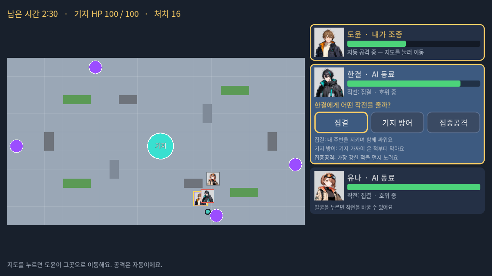
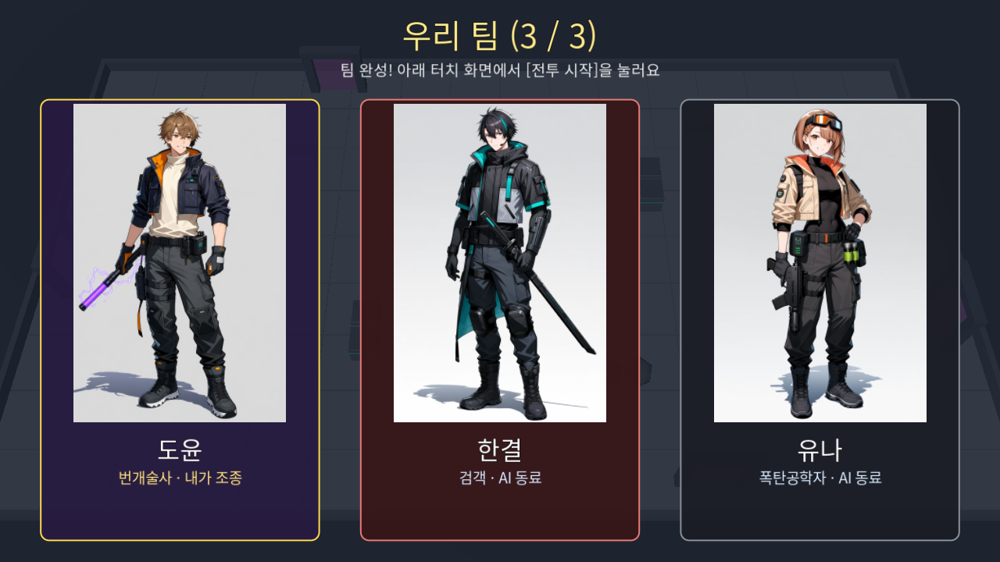
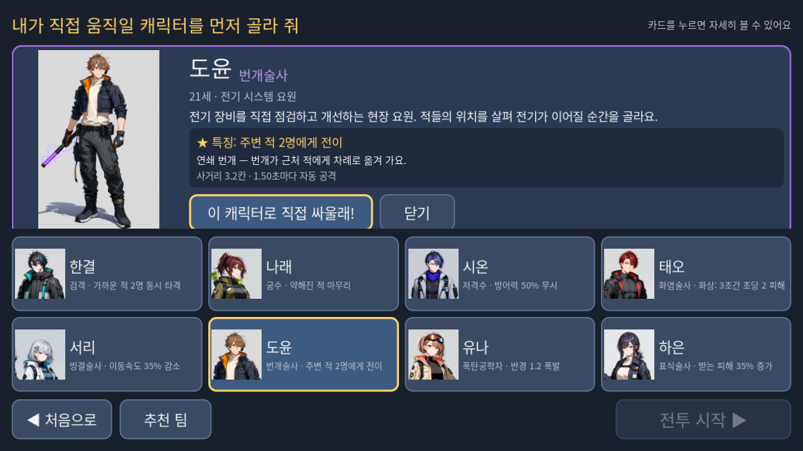

# AI 디펜스 v2.0 — 3D 스케치 서바이벌 (개발 브랜치 `v2-3d`)

기획: 「AI 디펜스 v2.0 — 3D 스케치 서바이벌」 개편 기획안 (2026-11-12).
이 브랜치는 기존 타워디펜스를 지우지 않고 **3D 서바이벌 모드를 새로 추가**한다. `main` 브랜치의 타워디펜스는 그대로이며,
이 브랜치에서도 `--td` 인자(또는 교사 메뉴 → 이전 타워디펜스 실행)로 실행할 수 있다.

## 현재 단계: 1차 — 3D 전투 시제품 (완료)

> "플레이어가 고정된 3D 맵에서 직접 이동하며, AI 동료 2명과 함께 몰려오는 적들을 자동으로 공격하고 기지를 방어하는 시제품"

| 기획 항목 | 상태 | 내용 |
|---|---|---|
| 고정 3D 맵 1개 | 완료 | 32×18칸 연구시설 광장, 중앙 청록 결정 기지, 게이트 4곳(서·북·동·남), 화단·상자·바위 장애물 |
| 대표 캐릭터 직접 이동 | 완료 | 터치 지도에서 누른 곳으로 이동(A* 경로, 장애물 위를 누르면 가장 가까운 빈 칸) |
| AI 동료 2명 | 완료 | 스스로 표적·위치 판단, 체력이 30% 아래면 기지로 물러나 회복 |
| 몬스터 2종 | 완료 | 결정 벌레(일반)·질주 사냥개(빠른 적). 갑옷·보스 데이터와 모델도 들어 있으나 1차 웨이브에는 넣지 않음 |
| 자동 공격 | 완료 | 기존 8종 고유 효과(2명 베기·방어 무시·화상·감속·연쇄·폭발·표식) 그대로 |
| 기지 방어 | 완료 | 기지 HP 100, 3분 버티면 성공 / 0이면 실패 |
| 터치스크린 조작 | 완료 | 2D 전술 지도(이동) + 캐릭터 얼굴(동료를 누르면 전술 선택) |
| 일반 모니터 전투 출력 | 완료 | 3D 고정 쿼터뷰, 이름·체력·말풍선 겹침 표시 |
| 전술 지시 (3차 항목 일부 선반영) | 완료 | 동료 얼굴 → 집결 / 기지 방어 / 집중공격. 동료별로 따로 |
| 말풍선 보고 (6.3) | 완료 | 실제 전황 근거만, 동시에 최대 2개 |
| 전신 원화 활용 | 완료 | 선택 상세, 위 모니터 팀 소개, 작전 개시 연출, 결과 |
| 그림 건설·AI 특별 제안·성장·건설 에너지 | 미구현 | 2차~4차. 경험치·에너지 수치는 이미 쌓이고 있음(표시만 안 함) |

## 실행

- 개발: Godot 4.7.2로 `ai_defense/project.godot` 열기 → 실행 (메인 장면 `src/survival/sv_main.tscn`)
- 인자: `--single`(한 화면에 두 창) · `--windowed` · `--td`(이전 타워디펜스) · `--selfcheck=<폴더>`(자동 전투 후 화면 저장·종료)
- 단축키·교사 메뉴는 기존과 같음 (F10 메뉴, F9 화면 역할 교환, F11 전체 화면, F3 FPS)

## 한 판 흐름 (약 4분)

1. 대기 → [시작]
2. 선택: 카드를 누르면 원화 상세 패널이 위에서 내려옴 → **첫 번째로 확정한 캐릭터 = 내가 조종**, 나머지 2명 = AI 동료. 위 모니터에 팀 원화 등장
3. 작전 개시 연출(2.6초, 3명 원화)
4. 전투 3분: 지도 누르기 = 이동, 동료 얼굴 누르기 = 전술. 쓰러지면 6초 뒤 기지에서 다시 일어남
5. 결과(원화·처치 수) → 30초 뒤 자동 초기화

## 구조

```
src/survival/
  sv_data.gd        data/survival.json 읽기 (맵·웨이브·적 행동·전술·대사)
  sv_grid.gd        2D 평면 격자: 장애물, 적용 흐름장(기지까지 거리), 아군 A*, 충돌 이동
  sv_state.gd       아군·적·투사체 상태, 깊은 복사
  sv_engine.gd      30Hz 전투 규칙 (기존 GameEngine의 공격 효과·피해 계산을 자유 이동에 맞게 옮김)
  sv_ai.gd          Utility AI: 표적 점수(기존 원칙 가중치 + 기지 거리·아군 위협·속도), 동료 이동 판단
  sv_session.gd     한 판 + 말풍선 + 학생 명령 기록
  sv_controller.gd  대기→선택→개시→전투→결과, 명령 순서번호 중복 방지
  sv_main.gd        두 창 관리 (기존 main.gd 방식)
  view/sv_world3d.gd     3D 장면 (카메라·조명·유닛 동기화·효과 재사용)
  view/sv_models.gd      임시 로우폴리 모델 (공통 몸체 + look 색 + 직업별 무기)
  view/sv_hud.gd         3D 위 2D 정보·말풍선·원화 장면
  view/sv_control_view.gd, sv_tactical_map.gd, sv_face.gd   터치 패널
data/survival.json   이 모드의 모든 수치 (재빌드 없이 exe 옆 data/에서 조정 가능)
tests/sv_tests.gd    3D 모드 자동 테스트
tools/sv_sim.gd      화면 없는 밸런스 시뮬레이션, tools/sv_smoke.gd 화면 점검
```

재사용: `GameData`(캐릭터·적·원칙 데이터), 원칙 가중치, 공격 효과 규칙, `TextUtil`, `HeroPortrait`(원화), `UiStyle`, 두 창 관리 방식, 테스트 구조.
분리: 기존 `GameEngine`·`Targeting`은 고정 경로 진행률을 전제로 하므로 손대지 않고 3D용을 따로 만들었다 → 기존 테스트 914개가 그대로 통과.

## AI에 대한 정직한 설명
- 동료 판단과 표적 선택은 **가중치 점수로 행동을 고르는 게임 AI(Utility AI)**. 신경망·생성형 AI가 아니다.
- 이동·장애물 판단은 3D 물리엔진이 아니라 2D 격자(흐름장·A*) 계산이며 3D 화면은 그 결과를 보여 준다.
- AI는 학생이 정한 전술을 스스로 바꾸지 않는다 (테스트 t06).

## 검증 결과 (2026-11-12, 개발 PC: GTX 1060 / 모니터 39Hz)

| 구분 | 결과 |
|---|---|
| 기존 2D 타워디펜스 테스트 `tests/run_tests.gd` | 914개 확인 모두 통과 (이 브랜치에서 재실행) |
| 3D 서바이벌 테스트 `tests/sv_tests.gd` | 12종·59개 확인 모두 통과 |
| 밸런스 `tools/sv_sim.gd` 30판 | 2초마다 위험한 적 쪽으로 이동하면 성공 80%·기지 평균 53/100, 전혀 안 움직이면 13% → 직접 조작이 결과를 바꿈 |
| 전투 계산 | 적 20마리 1틱 평균 약 1.8ms (30Hz 예산 33ms) |
| 화면 | 한 판 전체 자동 진행 스크린샷 확인. FPS: 화면 동기화 시 40(모니터 39Hz), 동기화 끄면 60 상한 |
| 빌드 | `AIDefense.exe` 단일 파일(PCK 포함, 약 142MB) 생성, exe 자가 점검으로 전투 진입 확인 |

**아직 안 한 것:** 부스 PC(i3-13100 / UHD 730) 실측, 실제 터치 모니터, 학생 시범. 개발 PC의 GPU 대신 내장그래픽으로 돌리는 측정도 하지 않음(Windows 그래픽 설정 변경 필요).

## 다음: 2차 — 그림 건설
터치 그림 입력 → 선 분석(직선·ㄱ자·U자·곡선) → 격자 보정 → 건설 가능 위치·아군 이동 경로 검사 → 미리보기 → 승인/다시 설계/취소 → 3D 벽 생성 → 흐름장 다시 계산(적 우회·벽 공격·내구도).
격자·흐름장이 이미 `set_blocked()` + `rebuild_flow()`로 벽 추가를 받을 수 있게 되어 있다.

## 화면 미리보기 (자동 점검 `tools/sv_smoke.gd`로 찍은 실제 화면)

| 위 모니터 (3D 전투) | 터치 패널 (지도 + 동료 전술) |
|---|---|
|  |  |
|  |  |
