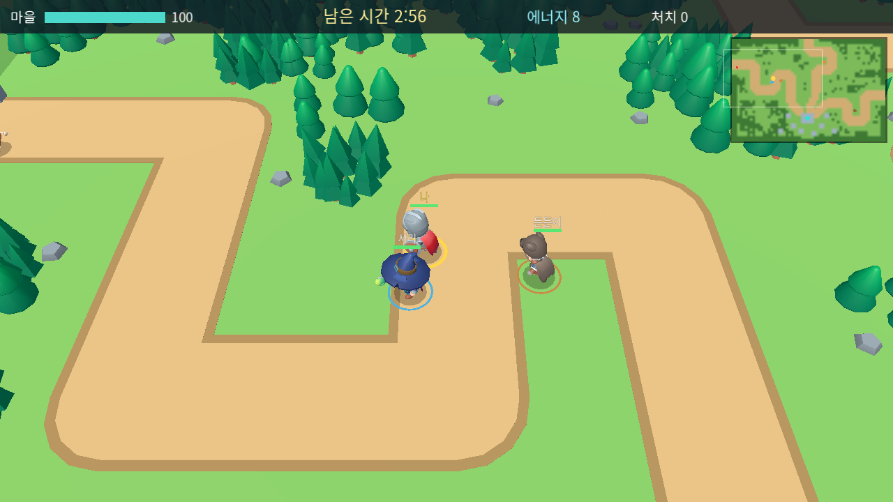
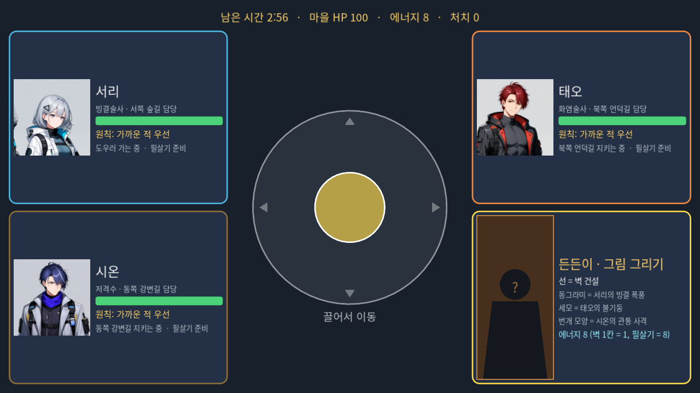
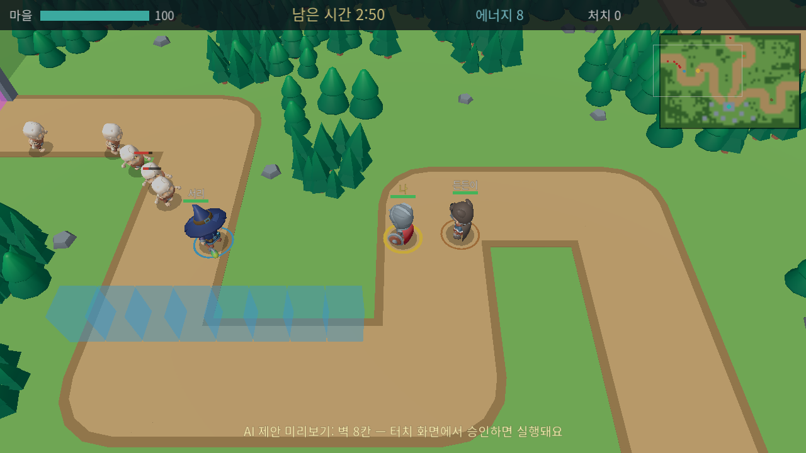
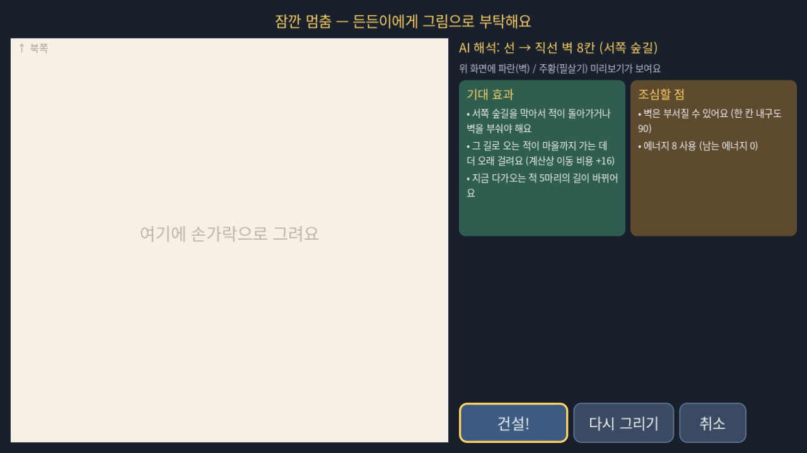
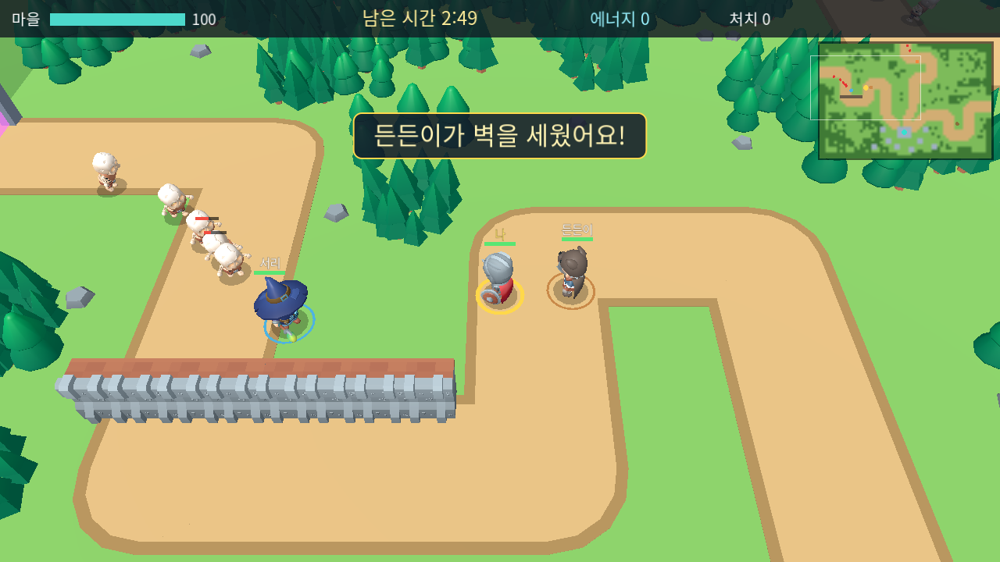
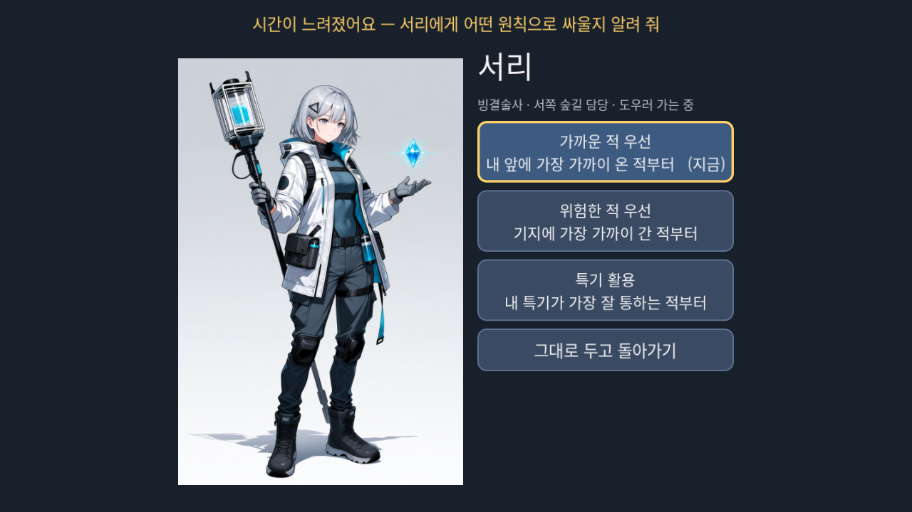
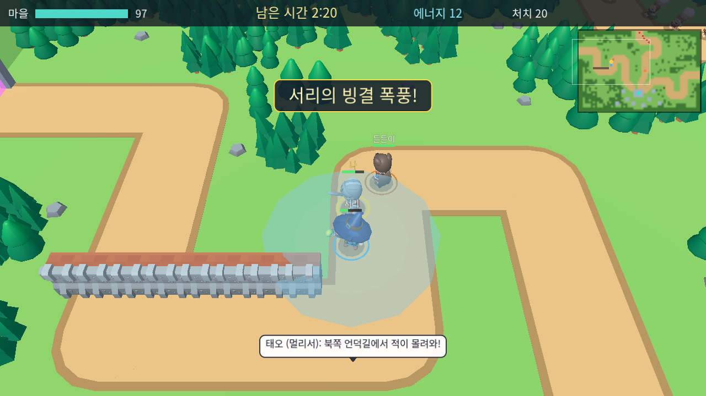

# AI 디펜스 v2.0 — 3D 스케치 서바이벌 (개발 브랜치 `v2-3d`)

기획: 「AI 디펜스 v2.0 — 3D 스케치 서바이벌」 개편 기획안 (2026-11-12) + 같은 날 받은 구조 변경 지시.
이 브랜치는 기존 타워디펜스를 지우지 않고 **3D 서바이벌 모드를 추가**한다. `main`의 타워디펜스는 그대로이며,
이 브랜치에서도 `--td` 인자(또는 교사 메뉴 → 이전 타워디펜스 실행)로 실행할 수 있다.

## 지금 구조 (v2 시제품 3판)

3판 변경 (피드백 반영): 세 갈래 길 → **지그재그 외길 하나**, 캐릭터 크기 축소, 머리 위 말풍선 → **화면 아래 대화창(초상화+이름)**, 적은 **무리로 와르르·더 빠르게**, 동료 공격은 **광역**(공격마다 범위 고리·폭발 효과).

### 등장인물 (게임 속 5명)
| 누구 | 조작 | 3D 모델 (KayKit) | 원화 |
|---|---|---|---|
| 나 (마을 수비대원) | 터치 패널 가운데 **조이스틱** | 기사 (검+방패) | 없음 → 실루엣 |
| 든든이 (건설 동료, 고를 수 없음) | 항상 내 옆을 따라다님, **그림대로 벽 건설** | 야만전사 (도끼) | 없음 → 실루엣 |
| 고른 동료 3명 (8명 중) | AI가 스스로: 외길의 **윗길·가운데 길·아랫길 구역을 하나씩 맡아** 광역 공격 | 도적·후드 도적·마법사 + 옷 색 | 기존 전신 원화 사용 |

### 맵
- 40×64칸. 맨 위 출현 게이트에서 **지그재그로 꺾이는 흙길 하나**가 맨 아래 **성벽(방어선)과 성문**까지 이어진다. 성벽 뒤가 마을.
- 적(스켈레톤)은 8~22마리씩 **무리로** 쏟아져 나와 **길을 따라** 빠르게 내려온다(풀밭은 비용 16이라 지름길로 잘 안 감). 성문에 닿으면 마을 HP가 깎인다. 카메라는 '나'를 따라다녀 맵 전체가 한 화면에 보이지 않는다 → 위 모니터 오른쪽 위 **미니맵**.
- 마을 HP가 0이 되면 실패, 3분 버티면 성공.

### 터치 패널 (아래 화면)
- **기본:** 사각형 네 모서리 = 고른 동료 3명 + 든든이, 가운데 = 조이스틱.
- **동료 초상화를 누르면:** 게임이 아주 느려지고(×0.15) 가운데에 그 동료의 **전신 원화**와 행동 원칙 3개(가까운 적 / 위험한 적 / 특기 활용) → 고르면 기본 화면으로.
- **든든이 초상화를 누르면:** 게임이 멈추고 **그림 칸**이 열린다.
  - 선(직선·ㄱ자·U자·곡선) → 든든이가 **그 모양대로 벽**을 세움. **크기와 위치는 AI가** 정함
  - 동그라미 → 첫째 동료 필살기, 세모 → 둘째, 번개 모양 → 셋째
  - AI가 해석 결과와 **기대 효과·조심할 점**을 보여 주고, 위 모니터에 미리보기(파란 벽 / 주황 범위)를 띄움
  - 학생이 **[건설!/필살기 사용!] [다시 그리기] [취소]** 중 고른다. 애매하면 AI가 "어떤 걸 그린 거야?" 하고 묻는다
- 선택 화면: 카드를 누르면 원화 상세가 위에서 내려오고, 확정하면 위 모니터에 원화가 등장 (고른 순서대로 윗길·가운데 길·아랫길 담당).

### 건설 에너지·필살기
- 시작 에너지 8 (벽 8칸 또는 필살기 1번), 적을 처치하면 늘어난다. 벽 1칸 = 1, 필살기 = 8, 필살기마다 15초 대기.
- 필살기: 회오리 베기, 화살비, 관통 사격, 불기둥, 빙결 폭풍, 번개 폭풍, 융단 폭격, 일제 표식.

## AI가 실제로 하는 계산 (기술적으로 정직한 설명)
모두 규칙과 점수 계산이며, 신경망·생성형 AI·이미지 인식 모델이 아니다.

| 기능 | 방법 |
|---|---|
| 그림 해석 | 같은 간격으로 다시 찍기 → 꺾인 점 찾기(RDP 단순화) → 닫힘 정도·꼭짓점 수·방향 바뀜 횟수로 분류 |
| 벽 크기·위치 | '나' 주변 14칸 안의 길 칸을 후보 중심으로 크기 4~8칸 후보를 만들고 점수: 길을 **가로지르는지**(벽 양 끝이 길 밖에 있는지), 다가오는 적 수, 거리, 에너지. 상위 4개는 맵 복사본에 실제로 세워 보고 **적이 마을까지 가는 비용 변화**와 **우리가 마을로 갈 길이 막히는지** 계산 |
| 적 길찾기 | 성문까지 비용 흐름장: 길 1, 풀밭 16, 벽 28(부숴야 함). 벽이 길을 막으면 돌아가는 게 싼지 부수는 게 싼지를 계산 결과로 고른다 |
| 동료 행동 | 맡은 길을 지키다 위험도 점수가 높은 적에게 감, 체력 30% 아래면 마을로 물러나 회복. 표적은 기존 원칙 가중치 + 마을까지 남은 거리 |
| 필살기 위치 | 그 동료 주변에서 적이 가장 많이 맞는 위치 계산 |
| 광역 공격 | 표적 주변 반경 안의 적을 모두 맞힘 (검: 베기 고리, 불: 폭발, 얼음: 냉기 파동, 번개: 연쇄, 저격: 관통, 폭탄: 투척 폭발). 반경은 `data/survival.json`의 `aoe` |
| 대화창 | 그 순간 실제 전황이 조건을 만족할 때만, 화면 왼쪽 아래 창에 초상화와 함께 (예: 한 구역에 적 8마리 이상 → "윗길에 적 무리가 몰려와!", 벽 없이 10마리 → "가운데 길에 벽이 있으면 좋겠어") |

학생이 승인하지 않으면 AI는 아무것도 짓거나 쓰지 않고, 동료의 행동 원칙도 스스로 바꾸지 않는다 (테스트 t06, t08, t10).

## 3D 에셋 (무료, CC0)
`assets/3d/kaykit/` — Kay Lousberg의 KayKit 팩 (Creative Commons Zero). 각 라이선스 파일 포함.
- Adventurers Character Pack 1.0: 기사·야만전사·마법사·도적·후드 도적 (애니메이션 76종 포함)
- Skeletons Character Pack 1.0: 적 4종 (스켈레톤 하수인·도적·전사·마법사)
- Medieval Hexagon Pack 1.0 일부: 마을 건물, 나무, 바위, 돌벽(건설용)
원본 받은 곳: https://github.com/KayKit-Game-Assets (2026-11-12). 출처 표기 의무는 없지만 문서에 남긴다.
예전 결정 몬스터·연구시설 그림은 3D에 쓰지 않았다(2D 타워디펜스에서는 그대로).

## 구조
```
src/survival/
  sv_data.gd        data/survival.json (맵·길·웨이브·필살기·건설·대사)
  sv_grid.gd        2D 격자: 길·숲·건물·벽(내구도), 적 비용 흐름장(이진 힙 다익스트라), 아군 A*
  sv_state.gd       나·든든이·동료 3명, 적, 벽, 에너지
  sv_engine.gd      30Hz 전투 규칙 + 벽 건설·필살기 실행 (승인 후에만 호출)
  sv_ai.gd          표적 점수, 동료 구역 판단, 든든이 따라가기
  sv_sketch.gd      손그림 해석
  sv_planner.gd     벽 크기·위치, 필살기 위치 계산 + 장단점
  sv_session.gd     한 판 + 학생 명령 + 제안 + 말풍선
  sv_controller.gd  대기→선택→개시→전투→결과, 슬로모션/멈춤, 명령 중복 방지
  sv_main.gd        두 창 관리
  view/  sv_world3d(3D·카메라·벽·미리보기·효과) sv_models(KayKit 모델·애니메이션) sv_hud(상단 바·미니맵·아래 대화창·원화 장면)
         sv_control_view(터치 패널) sv_joystick sv_sketch_pad sv_face(원화·실루엣)
tests/sv_tests.gd    3D 모드 자동 테스트 16종
tools/sv_sim.gd      화면 없는 밸런스 시뮬레이션 (bot=play|move|idle), tools/sv_smoke.gd 화면 점검
```

## 검증 결과 (2026-11-12, 개발 PC: GTX 1060, 모니터 39Hz)
| 구분 | 결과 |
|---|---|
| 기존 2D 타워디펜스 테스트 | 914개 모두 통과 |
| 3D 서바이벌 v2 테스트 (3판) | 73개 모두 통과 |
| 밸런스 (3판, 적 수 ×1.4·적 체력 ×2.2) | 그림까지 쓰는 봇 8판 성공 75%. 이동만/아무것도 안 함 봇은 아직 다시 재지 않음 |
| 계산 부담 | 전투 1틱 약 2.4ms(예산 33ms), 그림 해석+배치 약 0.5초(멈춘 상태에서) |
| 화면 | 선택→원칙(슬로모션)→그림 벽 제안·건설→필살기→결과까지 자동 진행 스크린샷 확인 |
| 빌드 | AIDefense.exe 157MB, exe 자가 점검으로 3D 에셋 표시·전투 진입 확인 |

**아직 안 한 것·한계**
- 부스 PC(i3-13100/UHD 730) 실측. 3D 캐릭터가 뼈대 애니메이션 모델(최대 25개)이라 내장그래픽 FPS 확인이 꼭 필요
- 실제 터치 모니터: 지금은 **한 손가락 조작 기준** (조이스틱을 누른 채 다른 손가락으로 초상화를 누르는 동시 터치는 아직 미지원)
- 나·든든이 원화(실루엣 임시), 사운드, 경험치 강화 화면, 다리 건설, AI 특별 제안(전략 제안 2회)은 다음 단계

## 화면 미리보기 (자동 점검 `tools/sv_smoke.gd`로 찍은 실제 화면)

| 위 모니터 | 터치 패널 |
|---|---|
|  |  |
|  |  |
|  |  |
|  | |
